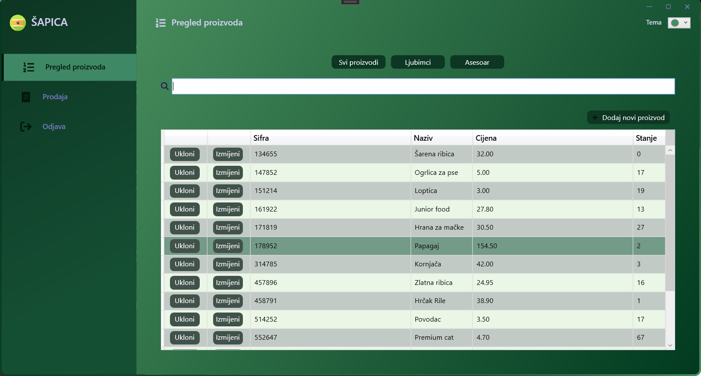
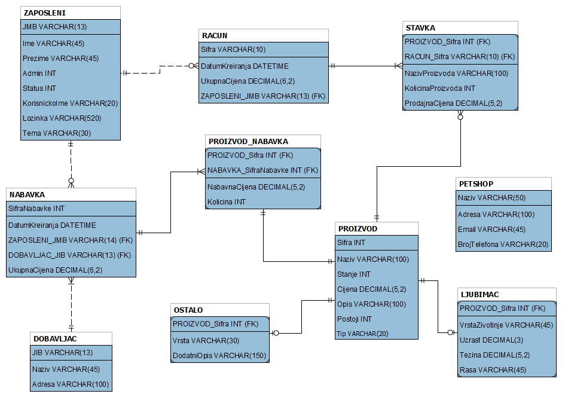
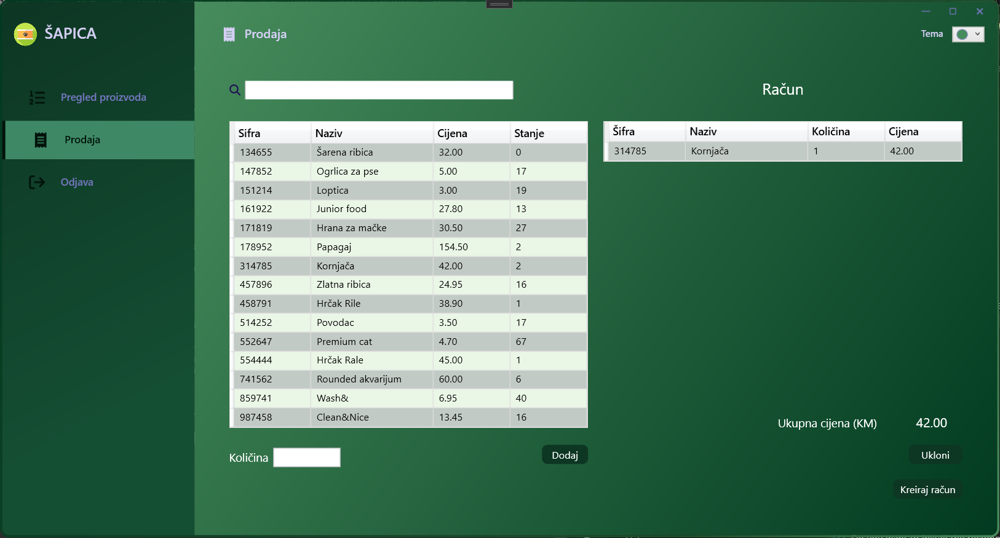
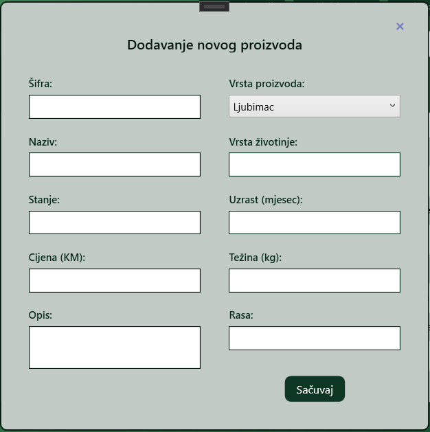
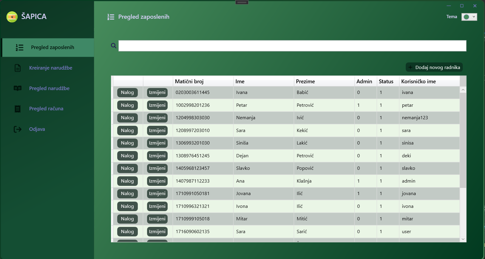
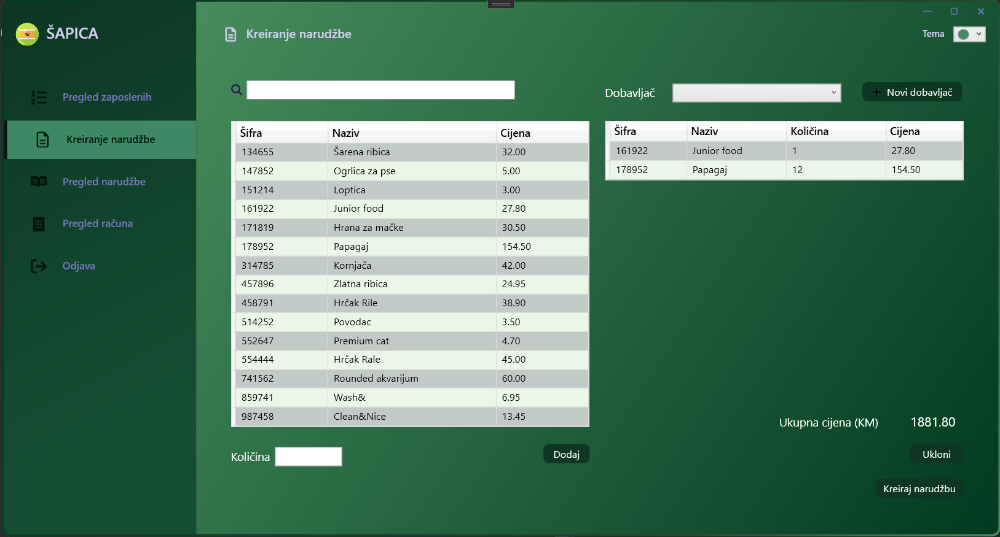
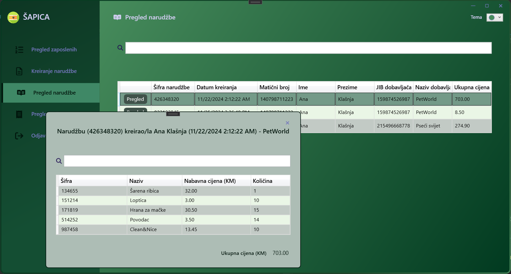
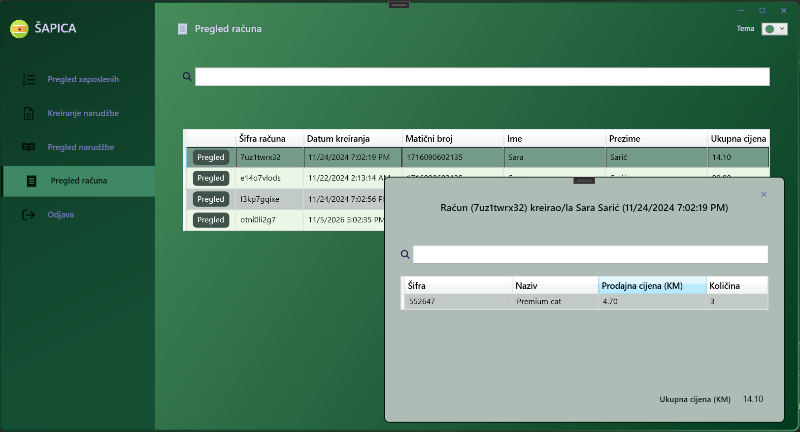
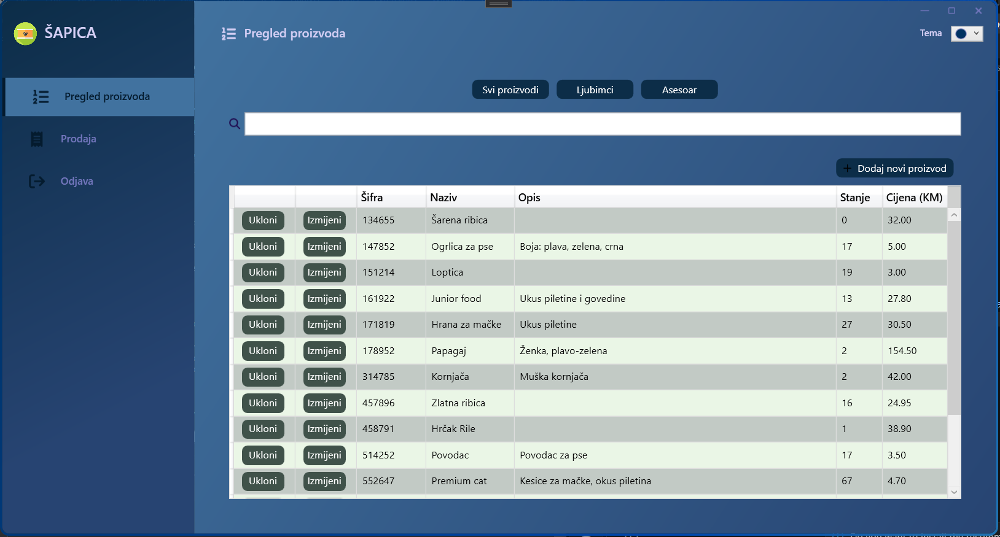
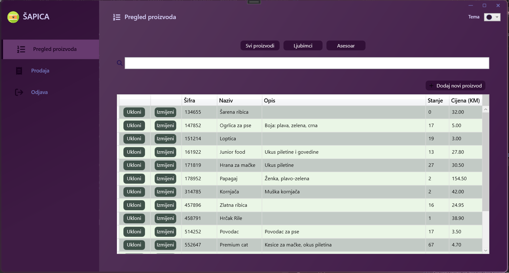

# PetShop – Pet Shop Management System

A desktop application for managing a pet shop, built with **C# / WPF** using the **MVVM** pattern and a **MySQL** database. It was developed as a project for the _Human-Computer Interaction_ course at the Faculty of Electrical Engineering, University of Banja Luka.

The app supports two kinds of user accounts. An **administrator** manages employees, supplier orders and receipts. An **employee** manages products and makes sales.

> The user interface is in Serbian, as the app was designed for a local pet shop.

<p align="center">
  
</p>

## Features

**Employee**

- Product overview with filters (all products / pets / accessories) and search
- Adding, editing and removing products. Pets and accessories have different fields (e.g. species, age, weight, breed).
- Sales: adding products to a receipt, live total price, automatic stock update

**Administrator**

- Employee management: add and edit employees, change their account (username / password), deactivate an account
- Creating orders from suppliers and adding new suppliers
- Browsing orders and receipts with their items

**General**

- Login with **SHA-256 password hashing**. Deactivated users cannot log in.
- Three color themes (green, blue, purple). The chosen theme is saved per user and applied at the next login.
- Search in every table

## Architecture and database

- **MVVM** pattern with a custom `ViewModelBase`, `RelayCommand` and `ViewModelCommand`
- Styles and themes kept in separate resource dictionaries (`styles/`)
- **MySQL** database with **14 stored procedures** for inserting, editing and searching data
- Parameterized SQL queries to prevent SQL injection
- Products are removed with a soft delete, so they are kept in the database for receipt history

<p align="center">
  
</p>

## Tech stack

| Technology                | Purpose                |
| ------------------------- | ---------------------- |
| C# / .NET Framework 4.7.2 | Application logic      |
| WPF (XAML)                | User interface         |
| MySQL 8 + MySql.Data      | Database and connector |
| FontAwesome.Sharp         | Icons                  |

## Screenshots

| Sales                          | Adding a pet                        |
| ------------------------------ | ----------------------------------- |
|  |  |

| Employees (admin)                        | New supplier order                      |
| ---------------------------------------- | --------------------------------------- |
|  |  |

| Orders                                    | Receipts                                     |
| ----------------------------------------- | -------------------------------------------- |
|  |  |

| Blue theme                                | Purple theme                                  |
| ----------------------------------------- | --------------------------------------------- |
|  |  |

## Getting started

**Requirements:** Windows, Visual Studio 2019 or newer (with the .NET desktop development workload), and MySQL Server 8.

1. Clone the repository:
   ```bash
   git clone https://github.com/ana-spiric/PetShop-WPF.git
   ```
2. Create the database by running `database/petshop.sql` in MySQL Workbench (or `mysql -u root -p < database/petshop.sql`). This creates the `hciprojekat` schema with sample data and stored procedures.
3. If your MySQL user or password differs, update the connection string in `Pet_Shop_HCI/App.config`.
4. Open `Pet_Shop_HCI.sln` in Visual Studio and press **F5**. NuGet packages are restored automatically.

**Demo accounts**

| Role          | Username | Password |
| ------------- | -------- | -------- |
| Administrator | `admin`  | `admin`  |
| Employee      | `user`   | `user`   |

## Project structure

```
Pet_Shop_HCI/
├── classes/      # ViewModels, MVVM base classes, DB connector, session
├── views/        # Windows and user controls (XAML + code-behind)
├── styles/       # Themes, colors and button styles
├── images/       # Icons and images
├── LogIn.xaml    # Login window
├── Admin.xaml    # Administrator main window
└── User.xaml     # Employee main window
database/
├── petshop.sql   # Schema, sample data and stored procedures
└── er-diagram.png
```

## Author

**Ana Spiric** - Software Engineering student
[GitHub](https://github.com/ana-spiric)
